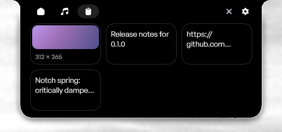
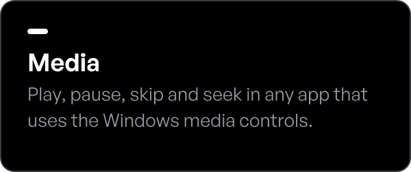
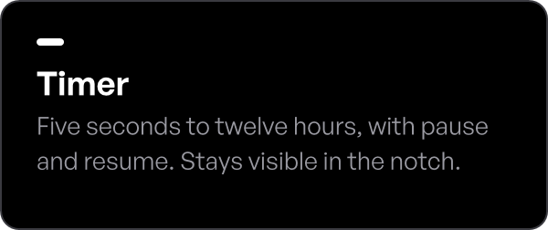
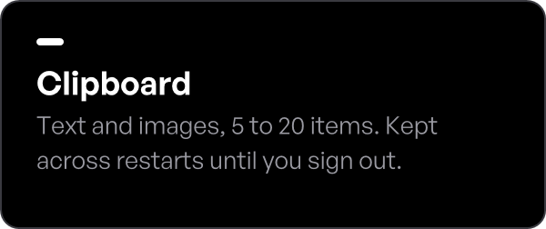
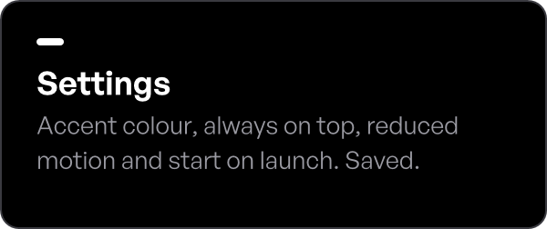
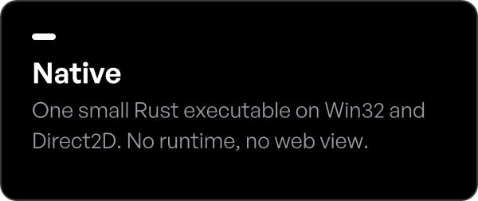

<p align="center">
  
</p>

<p align="center">
  A native notch for the top of your Windows desktop: the time, what is playing, a timer and your clipboard history, one click away.
</p>

<p align="center">
  <a href="https://github.com/ujvall/Oeca/releases/latest/download/Oeca-Setup.exe"></a>
  <a href="https://github.com/ujvall/Oeca/releases"></a>
  
  
</p>

<br>

<p align="center">
  
  <br>
  <sub>The Clipboard space, captured from Oeca 0.1.0 (example clipboard items).</sub>
</p>

## Features

<p align="center">
  
  
  
  <br>
  
  
  
</p>

Click an item in the Clipboard space to copy it again, or drag image files onto the notch to add them. A notification-area icon offers **Open**, **Settings** and **Quit**.

## How it is built

<p>
  
  
  
  
  
  
</p>

Oeca is a free, open-source (MIT) single Rust executable whose only dependencies are Microsoft's [`windows`](https://crates.io/crates/windows) and `windows-core` crates: no runtime, UI framework or web view.

- **Window.** One layered, per-monitor-DPI-aware Win32 window. Pixels outside the notch shape pass clicks through to the windows below.
- **Rendering.** Direct2D and DirectWrite draw into a premultiplied 32-bit bitmap that is composited with `UpdateLayeredWindow`. Brushes, text formats and bitmaps are cached per artwork and DPI.
- **Event-driven.** A blocking `GetMessageW` loop; clipboard changes, media sessions (`Windows.Media.Control`) and the tray all arrive as messages, with no polling. Animation timers run only while something moves; when nothing is playing or animating, Oeca only wakes for the clock's once-a-minute update.
- **Motion.** Opening, closing and switching spaces run on critically damped springs that keep their velocity when interrupted, and snap when Reduced motion is on.
- **Storage.** Settings live in `%LOCALAPPDATA%\Oeca\settings.ini`. Clipboard history is saved beside it, tied to the current Windows sign-in through a volatile registry key, so a new session never sees the previous one's history.

## Install

1. Download `Oeca-Setup.exe` from [Releases](https://github.com/ujvall/Oeca/releases).
2. Run it. Oeca installs for your Windows account only, to `%LOCALAPPDATA%\Programs\Oeca`; no administrator rights are needed.
3. Look for the notch at the top of your screen and the Oeca icon in the notification area.

The installer and app are not code-signed yet, so Windows SmartScreen may ask you to confirm; see the [code signing policy](#code-signing-policy). Oeca adds nothing that runs at startup unless you turn on **Start on launch** in Settings.

Uninstall from **Settings → Apps → Installed apps**. This removes the app, its shortcuts and its Start on launch entry, and keeps your data in `%LOCALAPPDATA%\Oeca`; delete that folder yourself to remove it. After a reinstall, Start on launch is off until you turn it on again.

## Build from source

Requires Windows 10 or later (x64), Rust with the MSVC toolchain (edition 2024), and the Windows 10/11 SDK, which comes with the Visual Studio C++ build tools. `build.rs` embeds the icon and version information with the SDK's `rc.exe` (set `RC` to use a specific one).

```powershell
git clone https://github.com/ujvall/Oeca.git
cd Oeca
cargo test --locked
cargo build --release --locked
.\target\release\Oeca.exe
```

### Installer

`installer/Oeca.iss` builds the setup with [Inno Setup](https://jrsoftware.org/isinfo.php) **6.7.0 or later** (its dark wizard style and colours need 6.7). Build the release executable first: the script refuses to package one that is older than the sources.

```powershell
cargo build --release --locked
& "$env:LOCALAPPDATA\Programs\Inno Setup 6\ISCC.exe" installer\Oeca.iss
```

The output is `target\installer\Oeca-Setup.exe`, and its version comes from `Cargo.toml`. The same steps run on GitHub Actions in [`.github/workflows/release.yml`](.github/workflows/release.yml), which builds, tests and packages Oeca on GitHub-hosted Windows runners. Upgrading or reinstalling asks a running Oeca to quit, replaces it in place and keeps settings, clipboard history and Start on launch. Adjust the compiler path if Inno Setup is installed elsewhere.

## Project structure

```text
Oeca/
├── src/
│   ├── main.rs                Entry point
│   ├── window.rs              Window, message loop, gestures, single instance, lifecycle
│   ├── renderer.rs            Direct2D and DirectWrite rendering
│   ├── layout.rs              DPI-scaled layout
│   ├── config.rs              Geometry, springs and colours
│   ├── space.rs               Spaces and the settings model
│   ├── media.rs               Media sessions, artwork and visualizer
│   ├── clock.rs               Clock
│   ├── timer.rs               Countdown timer
│   ├── clipboard.rs           Clipboard history
│   ├── clipboard_store.rs     Session-scoped history storage
│   ├── dragdrop.rs            Image drag and drop
│   ├── settings_window.rs     Settings window
│   ├── settings_store.rs      Settings file
│   ├── startup.rs             Start on launch
│   └── tray.rs                Notification area icon and menu
├── assets/                    Icon, version resource and README images
├── installer/                 Inno Setup script and wizard images
└── build.rs                   Embeds the icon and version information
```

## Privacy

Oeca makes no network requests unless you ask it to check for updates: from version 0.3.0, Check for updates (Settings, About) and the optional Check for updates automatically setting, off by default, send one HTTPS request to GitHub's public releases API, with no account or personal data. Oeca never downloads or installs anything itself, and it has no telemetry, analytics or crash reporting. Its settings and its clipboard history are stored only on your PC, in `%LOCALAPPDATA%\Oeca`; the clipboard history is not encrypted and is discarded when you sign out or restart Windows. The full [privacy policy](website/app/privacy/page.tsx) covers the app, the installer and the website. It will also be published on the Oeca website once that is online.

## Code signing policy

**Status: pending.** Oeca is applying for free code signing from [SignPath Foundation](https://signpath.org). Current releases, including v0.2.0, are not signed. Once the application is accepted, releases will be built by the GitHub Actions workflow in this repository, signed through SignPath and published here, with this notice: Free code signing provided by SignPath.io, certificate by SignPath Foundation.

- Authors, Reviewers and Approvers: [Ujval Sai (@ujvall)](https://github.com/ujvall), currently the only maintainer.
- Every signing request is approved manually by the maintainer, for releases built from this repository only.
- Privacy: this program will not transfer any information to other networked systems unless specifically requested by the user or the person installing or operating it.

The full [code signing policy](website/app/code-signing/page.tsx) will also be published on the Oeca website.

## Contributing

Bug reports, feature requests and pull requests are welcome. See [CONTRIBUTING.md](CONTRIBUTING.md) for how to report a problem, propose a change and build and test Oeca locally. Contributions are accepted under the MIT License.

## License and credits

Oeca is free and open-source software, released under the [MIT License](LICENSE). The MIT License covers Oeca's source code and its own assets, including the Oeca icon and the images in `assets/` and `installer/images/`. It does not grant rights to the Oeca name or logo as trademarks: please don't use them to brand other software or imply endorsement.

Oeca was first published under the MIT License, including the v0.1.0 release. For a short time one commit (`c627fd2`) replaced it with a proprietary source-available licence; that change has been reversed, and it never revoked any rights granted under the MIT License.

Third-party components keep their own licences. Those shipped with Oeca, Microsoft's `windows` crates (MIT), the General Sans typeface embedded in official builds (ITF Free Font License, not open source), the Sunghyun Sans typeface used by the timer (SIL Open Font License 1.1) and Inno Setup, are listed with their notices in [THIRD-PARTY-NOTICES.txt](THIRD-PARTY-NOTICES.txt), which the installer places beside `Oeca.exe`.

- Icons in the app: Oeca's own, drawn from simple shapes by [assets/icons/generate.py](assets/icons/generate.py) and covered by the MIT License like the rest of the code.
- Screenshots of Oeca 0.1.0 in this README and on the website show its earlier icons, [designed by UIcons from Flaticon](https://www.flaticon.com/uicons), used under Flaticon's free licence with attribution.
- Oeca's text and wordmark are set in General Sans, © Indian Type Foundry ([Fontshare](https://www.fontshare.com/fonts/general-sans)). General Sans is not open source: it is used under the [ITF Free Font License](https://www.fontshare.com/licenses/itf-ffl), which lets official builds embed it in `Oeca.exe` but does not allow publishing the font files here, so they are not in this repository. To build with it, see [assets/fonts/README.md](assets/fonts/README.md); without it, Oeca uses the fonts installed on the PC.
